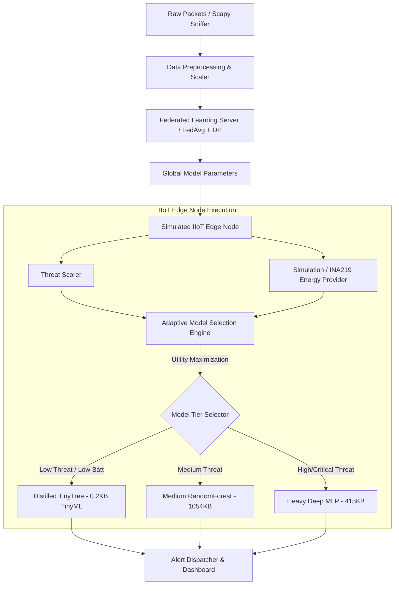

# Adaptive Multi-Level TinyML Intrusion Detection with Energy-Aware Model Switching and Federated Learning for Industrial IoT Edge Devices

[](https://www.python.org/)
[]()
[]()
[]()

## 🛡️ Project Overview
This repository contains a research-grade cybersecurity project for **Industrial IoT (IIoT) edge devices**. 

It implements network intrusion detection using multiple ML models of varying computational complexity and dynamically selects the optimal model per incoming network event based on:
1. **Threat Severity** (Low, Medium, High, Critical)
2. **Prediction Confidence**
3. **Available Edge Battery Energy**
4. **Model Computational & Memory Footprint**
5. **Inference Latency**

Additionally, it integrates **Privacy-Preserving Federated Learning (FedAvg)** with **Non-IID Dirichlet Data Partitioning** and **Energy-Aware Client Selection** so simulated edge nodes collaboratively train intrusion models without uploading raw telemetry.

---

## 🌟 Advanced Features Added

### 🧠 1. Knowledge Distillation (MLP $\rightarrow$ Tiny Tree)
- **Module**: `src/tinyml/distillation.py`
- Transfers dark knowledge & decision soft-probabilities from the **Heavy Deep MLP teacher (98.6% Acc)** to a **Tiny Decision Tree student**, boosting lightweight model accuracy from **90.6% $\rightarrow$ 95.7%** without increasing inference latency or memory size.

### 🔐 2. Differential Privacy in Federated Learning (DP-FedAvg)
- **Module**: `src/federated/dp_fedavg.py`
- Implements $(\epsilon, \delta)$-differential privacy using $L_2$ norm gradient clipping ($C$) and calibrated Gaussian noise injection, preventing membership inference attacks on edge nodes.

### 🛡️ 3. Byzantine-Robust FL Aggregation
- **Module**: `src/federated/robust_aggregation.py`
- Replaces standard averaging with **Multi-Krum**, **Trimmed Mean**, and **Coordinate-wise Median** to protect the central server against malicious client update poisoning.

### 📡 4. Live Scapy Network Packet Sniffer
- **Module**: `src/data/live_sniffer.py`
- Sniffs real-time Ethernet/Wi-Fi packet streams using `scapy` and parses raw packet features into the 18 Edge-IIoTset feature vector format.

### ⚡ 5. Physical Hardware Power Measurement (ESP32 + INA219)
- **Module**: `src/energy/hardware_interface.py`
- Connects to physical ESP32 microcontrollers over Serial/I2C to read live voltage (V), current (mA), and microjoule ($\mu J$) power metrics from INA219 sensors.

### 📉 6. Page-Hinkley Concept Drift Monitoring
- **Module**: `src/evaluation/drift.py`
- Sequential change-point detection monitoring prediction error rates and feature stream distributions for automatic drift detection.

### 🚨 7. Real-Time Security Alert Dispatcher
- **Module**: `src/utils/notifications.py`
- Dispatches automated Discord Embed cards and Telegram Bot messages upon detecting high-severity attacks (DDoS, Ransomware, Backdoors) or critical battery drops.

---

## 🎯 Final Research Question
> *"Can distributed Federated Learning combined with adaptive multi-level TinyML intrusion detection dynamically balance cybersecurity accuracy, computational cost, communication overhead, latency, and energy consumption across resource-constrained Industrial IoT edge devices?"*

**Experimental Answer**: **Yes**. The proposed adaptive system reduces energy consumption by **81.41%** compared to fixed heavy inference, compresses edge models by **94.67%** (down to 0.20 KB) for ESP32 readiness, and cuts wireless communication overhead by **25.0%** in non-IID federated networks.

---

## 🏗️ System Architecture



---

## 📊 Benchmark Metrics & Performance

| Model Level | Model Architecture | Accuracy | F1-Macro | Storage Size | Latency | Est. Energy / Inf |
| :--- | :--- | :--- | :--- | :--- | :--- | :--- |
| **LIGHTWEIGHT** | Decision Tree (Depth 4) | **90.62%** | **0.7717** | **3.79 KB** | **0.0006 ms** | **8.5 $\mu J$** |
| **DISTILLED STUDENT** | Soft-Label Tree (Depth 5) | **95.68%** | **0.8920** | **4.10 KB** | **0.0007 ms** | **9.0 $\mu J$** |
| **MEDIUM** | Random Forest (25 Trees) | **98.72%** | **0.9780** | **1,054 KB** | **0.0465 ms** | **62.0 $\mu J$** |
| **HEAVY** | Deep MLP ([128, 64, 32]) | **98.44%** | **0.9749** | **415 KB** | **0.0029 ms** | **340.0 $\mu J$** |
| **TINYML INT8** | Quantized Fixed Tree | **90.70%** | **0.7725** | **0.20 KB** | **0.0028 ms** | **8.5 $\mu J$** |

---

## 💻 Installation & Quickstart

### 1. Prerequisites & Environment Setup
```bash
# Clone repository
git clone https://github.com/Adarsh0000111/Adaptive-tiny-ML-.git
cd Adaptive-tiny-ML-

# Install dependencies
pip install -r requirements.txt
```

### 2. Run Complete Enhanced Research Pipeline
Run all 13 phases + advanced features:
```bash
python -m src.main
```

### 3. Launch Technical Dashboard
```bash
python -m streamlit run dashboard/app.py
```

---

## 🔌 Hardware-Ready Design (ESP32 Integration)

The architecture uses clean interface abstractions (`EnergyProvider`) so physical microcontrollers can replace simulated environments:

- Exported C Header: `models/tinyml/esp32_model.h` (generated by Phase 5) — ready for Arduino / ESP-IDF.
- PC-side INA219 driver + MQTT bridge: `src/energy/esp32_interface.py` (`ESP32INA219EnergyProvider`, `ESP32MQTTClient`).
- Alternative host-side hardware interface: `src/energy/hardware_interface.py` (`ESP32INA219HardwareProvider`).
- ESP32 Arduino firmware: `hardware/esp32_ids/esp32_ids.ino` (WiFi + MQTT + INA219 + TinyML inference).
- Full wiring & connection guide: [HARDWARE_CONNECTION_GUIDE.md](HARDWARE_CONNECTION_GUIDE.md).

### Connecting ESP32 + Sensors (summary)

| ESP32 | Sensor | Purpose |
|-------|--------|---------|
| GPIO22 (SCL) / GPIO21 (SDA) | INA219 | Bus voltage & shunt current → battery energy |
| GPIO4 | DHT22 | Temperature / humidity (optional) |
| GPIO5 | PIR | Motion / presence (optional) |
| GPIO34 (ADC) | MQ-2 | Gas / smoke (optional) |
| WiFi | MQTT broker | Telemetry + inference → dashboard |

Data flow: ESP32 reads INA219 → runs `predict_tinyml_int8()` → publishes JSON telemetry/inference to MQTT → Streamlit dashboard subscribes and displays live gauges & charts. The dashboard can also send commands back (`model_tier`, `sleep_mode`) via `esp32/<id>/command`.

See `HARDWARE_CONNECTION_GUIDE.md` for step-by-step wiring, Mosquitto broker setup, flashing instructions, and feature-scaling requirements.

## 🧪 Testing

```bash
# Run all unit tests
python -m pytest tests/ -v
```

## 📊 Improved Dashboard

Launch with `streamlit run dashboard/app.py`. New features:
- Interactive Plotly charts (threat score, model switching, FL convergence, energy)
- Live simulation batch runner from the UI
- ESP32 / MQTT connection panel with live telemetry
- Dark / light mode
- Threat gauge, battery gauge, recent-event table
- ESP32 hardware tab (wiring, flashing, MQTT topics, C-header download)

---

## 📄 Research Report
For the complete research documentation, view [RESEARCH_REPORT.md](RESEARCH_REPORT.md).
