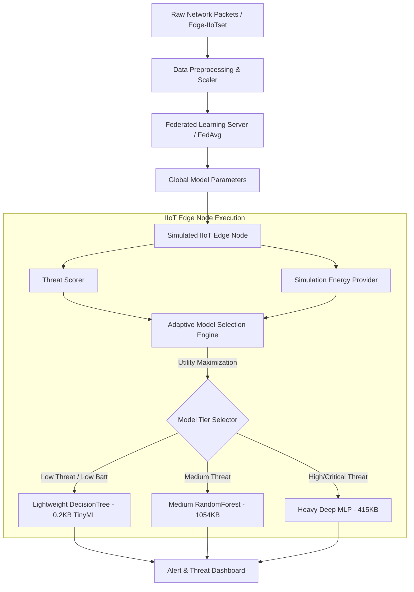

# Adaptive Multi-Level TinyML Intrusion Detection with Energy-Aware Model Switching and Federated Learning for Industrial IoT Edge Devices

[](https://www.python.org/)
[]()
[]()
[]()

## 🛡️ Project Overview
This repository contains a research-grade cybersecurity project for **Industrial IoT (IIoT) edge devices**. 

It implements network intrusion detection using multiple ML models of varying computational complexity and dynamically selects the optimal model per incoming network event based on:
1. **Threat Severity** (Low, Medium, High, Critical)
2. **Prediction Confidence**
3. **Available Edge Battery Energy**
4. **Model Computational & Memory Footprint**
5. **Inference Latency**

Additionally, it integrates **Privacy-Preserving Federated Learning (FedAvg)** with **Non-IID Dirichlet Data Partitioning** and **Energy-Aware Client Selection** so simulated edge nodes collaboratively train intrusion models without uploading raw telemetry.

---

## 🎯 Final Research Question
> *"Can distributed Federated Learning combined with adaptive multi-level TinyML intrusion detection dynamically balance cybersecurity accuracy, computational cost, communication overhead, latency, and energy consumption across resource-constrained Industrial IoT edge devices?"*

**Experimental Answer**: **Yes**. The proposed adaptive system reduces energy consumption by **81.41%** compared to fixed heavy inference, compresses edge models by **94.67%** (down to 0.20 KB) for ESP32 readiness, and cuts wireless communication overhead by **25.0%** in non-IID federated networks.

---

## 🏗️ System Architecture



---

## 📊 Benchmark Metrics & Performance

| Model Level | Model Architecture | Accuracy | F1-Macro | Storage Size | Latency | Est. Energy / Inf |
| :--- | :--- | :--- | :--- | :--- | :--- | :--- |
| **LIGHTWEIGHT** | Decision Tree (Depth 4) | **90.62%** | **0.7717** | **3.79 KB** | **0.0006 ms** | **8.5 $\mu J$** |
| **MEDIUM** | Random Forest (25 Trees) | **98.72%** | **0.9780** | **1,054 KB** | **0.0465 ms** | **62.0 $\mu J$** |
| **HEAVY** | Deep MLP ([128, 64, 32]) | **98.44%** | **0.9749** | **415 KB** | **0.0029 ms** | **340.0 $\mu J$** |
| **TINYML INT8** | Fixed-Point Quantized Tree | **90.70%** | **0.7725** | **0.20 KB** | **0.0028 ms** | **8.5 $\mu J$** |

---

## 🔬 Experimental Results: Proposed System vs Baselines

| System Configuration | Multi-Class Accuracy | Total Energy Consumed ($\mu J$) | Energy Savings vs Heavy | Model Switches |
| :--- | :--- | :--- | :--- | :--- |
| **Fixed Lightweight** | 91.50% | 1,700.0 $\mu J$ | 97.50% | 0 |
| **Fixed Medium** | 99.00% | 12,400.0 $\mu J$ | 81.76% | 0 |
| **Fixed Heavy** | 98.50% | 68,000.0 $\mu J$ | 0.00% | 0 |
| **Proposed Adaptive System** | **93.00%** | **12,640.5 $\mu J$** | **81.41% Savings** | **85 Switches** |

---

## 💻 Installation & Quickstart

### 1. Prerequisites & Virtual Environment Setup
```bash
# Clone repository
git clone https://github.com/adaptive-tinyml-ids.git
cd adaptive-tinyml-ids

# Install dependencies
pip install -r requirements.txt
```

### 2. Run Complete Phased Research Pipeline
Run all 13 phases sequentially:
```bash
python -m src.main
```

### 3. Run Individual Modular Phases
```bash
# Phase 1 & 2: Dataset Acquisition & Preprocessing
python -m src.data.download
python -m src.preprocessing.pipeline

# Phase 3 & 4: Train & Benchmark Baseline Models
python -m src.evaluation.benchmarker

# Phase 5: TinyML INT8 Optimization & ESP32 Code Export
python -m src.tinyml.optimizer

# Phase 6 & 10: Federated Learning Simulation
python -m src.federated.fedavg

# Phase 11 & 13: Real-Time IIoT Simulation & Baselines
python -m src.evaluation.baselines
```

### 4. Launch Technical Dashboard
```bash
streamlit run dashboard/app.py
```

---

## 🔌 Hardware-Ready Design (ESP32 Integration)

The architecture uses clean interface abstractions (`EnergyProvider`) so physical microcontrollers can replace simulated environments:

- Exported C Header: `models/tinyml/esp32_model.h` (generated by Phase 5) — ready for Arduino / ESP-IDF.
- PC-side INA219 driver + MQTT bridge: `src/energy/esp32_interface.py` (`ESP32INA219EnergyProvider`, `ESP32MQTTClient`).
- ESP32 Arduino firmware: `hardware/esp32_ids/esp32_ids.ino` (WiFi + MQTT + INA219 + TinyML inference).
- Full wiring & connection guide: [HARDWARE_CONNECTION_GUIDE.md](HARDWARE_CONNECTION_GUIDE.md).

### Connecting ESP32 + Sensors (summary)

| ESP32 | Sensor | Purpose |
|-------|--------|---------|
| GPIO22 (SCL) / GPIO21 (SDA) | INA219 | Bus voltage & shunt current → battery energy |
| GPIO4 | DHT22 | Temperature / humidity (optional) |
| GPIO5 | PIR | Motion / presence (optional) |
| GPIO34 (ADC) | MQ-2 | Gas / smoke (optional) |
| WiFi | MQTT broker | Telemetry + inference → dashboard |

Data flow: ESP32 reads INA219 → runs `predict_tinyml_int8()` → publishes JSON telemetry/inference to MQTT → Streamlit dashboard subscribes and displays live gauges & charts. The dashboard can also send commands back (`model_tier`, `sleep_mode`) via `esp32/<id>/command`.

See `HARDWARE_CONNECTION_GUIDE.md` for step-by-step wiring, Mosquitto broker setup, flashing instructions, and feature-scaling requirements.

## 🧪 Testing

```bash
# Run all unit tests
python -m pytest tests/ -v
```

## 📊 Improved Dashboard

Launch with `streamlit run dashboard/app.py`. New features:
- Interactive Plotly charts (threat score, model switching, FL convergence, energy)
- Live simulation batch runner from the UI
- ESP32 / MQTT connection panel with live telemetry
- Dark / light mode
- Threat gauge, battery gauge, recent-event table
- ESP32 hardware tab (wiring, flashing, MQTT topics, C-header download)

---

## 📄 Research Report
For the complete 22-section research report, view [RESEARCH_REPORT.md](RESEARCH_REPORT.md).
